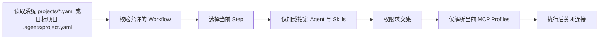

# Agent Flow

这是一个按项目和步骤动态解析 Agent、Workflow、Skill 与 MCP profile 的本地配置仓库。它不会在启动时读取全部 Skills，也不会连接全部 MCP。

## 快速开始

```bash
cd /Users/stupidur/Work/Agents
python3 -m venv .venv
.venv/bin/pip install -e .
.venv/bin/agentflow validate
.venv/bin/agentflow plan product-spec --set existing_behavior_required=true
```

不安装也可以直接运行：

```bash
PYTHONPATH=src python3 -m agentflow validate
PYTHONPATH=src python3 -m agentflow plan shopify-development \
  --set source_design=existing \
  --set visual_validation_required=true
PYTHONPATH=src python3 -m agentflow doctor
```

## 从任意项目目录使用

AgentFlow 的中央配置目录是 `/Users/stupidur/Work/Agents`。建议安装一次可编辑命令，并设置中央目录变量：

```bash
# 如果尚未安装 pipx：brew install pipx && pipx ensurepath
pipx install --editable /Users/stupidur/Work/Agents

# 写入 ~/.zshrc 后重新打开终端，或先在当前终端执行
export AGENT_SYSTEM_ROOT=/Users/stupidur/Work/Agents
```

如果不使用 pipx，也可以直接使用仓库虚拟环境中的绝对路径：

```bash
/Users/stupidur/Work/Agents/.venv/bin/pip install --editable /Users/stupidur/Work/Agents
export PATH="/Users/stupidur/Work/Agents/.venv/bin:$PATH"
export AGENT_SYSTEM_ROOT=/Users/stupidur/Work/Agents
```

设置完成后，无论当前位于哪个项目目录，都可以这样使用：

```bash
cd /path/to/shopify-project
agentflow register --type shopify
agentflow bootstrap
agentflow plan shopify-development --set source_design=existing
```

如果没有设置 `AGENT_SYSTEM_ROOT`，命令会把当前工作目录误认为 Agent System 根目录；这时需要每次显式传入 `--system-root /Users/stupidur/Work/Agents`。

## 命令速查

`agentflow` 提供项目初始化和 Workflow handoff 文件生成。生成的文件可以交给 Codex、Claude Code、OpenCode 或其他执行器手动执行；`run` 仍作为可选的 Codex 快捷方式保留。

| 命令 | 作用 | 是否执行任务 |
|---|---|---|
| `register` | 在目标项目创建轻量 `.agents/project.yaml` 入口 | 否 |
| `bootstrap` | 把 Agent、Skills、Rules、MCP Profile、公共 Memory 复制到项目，并生成 Codex/Claude/OpenCode/OMP 适配器 | 否 |
| `plan` | 生成可交给任意 Agent 客户端的 `workflow.md` 和机器可读的 `plan.json` | 否 |
| `run` | 可选：保存计划并调用 Codex 按步骤执行 | 是 |
| `validate` | 检查中央 AgentFlow 配置、Workflow、Skill 和 MCP 引用 | 否 |
| `doctor` | 检查 Python、tmux、dmux 等本地编排依赖 | 否 |

### `register`：登记项目

每个目标项目执行一次。它只创建项目入口，不复制 Skills，也不连接 MCP：

```bash
PYTHONPATH=src python3 -m agentflow \
  --system-root /Users/stupidur/Work/Agents \
  register \
  --type shopify \
  --project /path/to/shopify-project
```

可选项目类型：`default`、`java`、`shopify`。如果项目已经注册，默认不会覆盖；只有确认需要替换时才使用 `--force`。

### `bootstrap`：初始化能力文件

在 `register` 之后执行。它会根据项目允许的 Workflow，把实际 Agent、Skills、Rules、MCP Profile 复制到目标项目，并生成客户端薄适配器：

```bash
PYTHONPATH=src python3 -m agentflow \
  --system-root /Users/stupidur/Work/Agents \
  bootstrap \
  --project /path/to/shopify-project
```

默认生成 Codex、Claude Code、OpenCode、Oh My Pi 四种适配器。只需要部分客户端时，可以重复使用 `--client`：

```bash
PYTHONPATH=src python3 -m agentflow \
  --system-root /Users/stupidur/Work/Agents \
  bootstrap --project /path/to/project \
  --client codex \
  --client claude
```

`bootstrap` 只初始化文件，不会执行 Shopify 开发，也不会要求 Figma URL。

### 全局公共层：`--global`

`register` 和 `bootstrap` 默认仍使用当前目录，也可以通过 `--project`
选择项目。添加 `--global` 后，安装目标改为 `~/.agents/`；`--global`
与 `--project` 互斥。

```bash
# 首次全局登记时，通过环境变量或 --system-root 指定中央配置仓库
export AGENT_SYSTEM_ROOT=/path/to/agents-flow
agentflow register --type shopify --global
agentflow bootstrap --global --client codex
```

全局布局如下，不会再嵌套一层 `.agents/`：

```text
~/.agents/
├── project.yaml       # 全局默认项目类型、允许的 Workflow、中央仓库路径
├── AGENTS.md          # 全局规则入口
├── agents/
├── skills/
├── rules/
├── memory/
├── mcp/
│   ├── profiles/
│   └── manifest.json
└── clients/           # 选定客户端的薄适配文件
```

自定义目录可使用 `AGENTFLOW_GLOBAL_ROOT`，也可以传入 `--global-root`：

```bash
agentflow register --type shopify --global --global-root /workspace/.agents
agentflow bootstrap --global --global-root /workspace/.agents --client codex
export AGENTFLOW_GLOBAL_ROOT=/workspace/.agents
```

全局注册后，未注册的项目使用全局项目类型生成计划；当前目录仍是任务根目录。
已有项目登记继续决定该项目允许的 Workflow 和权限，全局配置不会扩展其权限。
生成计划时会引用全局 `AGENTS.md`、rules 和公共记忆入口；本地没有技能或
MCP profile 时，使用全局安装路径。

```bash
cd /path/to/shopify-theme
agentflow plan shopify-project-onboarding
agentflow plan shopify-development --set source_design=existing
```

计划要求生成的项目 `AGENTS.md` 包含“全局规则”引用，并遵守适用的全局约束；
项目规则不能静默放宽全局规则。项目结构和需求仍必须来自实际发现证据。
全局文件只作为只读上下文，任务代码、`AGENTS.md` 和产物写在目标项目中。

在全局模式下，Shopify 初始化器可复用已有全局规则和适配文件：

```bash
python3 "$AGENT_SYSTEM_ROOT/skills/shopify/initialize-shopify-project/scripts/init_shopify_project.py" \
  --target /path/to/shopify-theme --global-root "$AGENTFLOW_GLOBAL_ROOT" --dry-run
```

去掉 `--dry-run` 后仅合并项目的 `.env` 空占位和 `.gitignore`；默认不重复复制
全局规则或客户端配置。生成项目 `AGENTS.md` 仍由 onboarding 的证据交接完成。

全局 bootstrap 保留冲突文件，替换仍需显式 `--force`。MCP profile 和客户端
适配文件属于配置产物，不会安装或启动服务。`clients/` 中的适配文件需要由
执行器集成；不会覆盖已有 `~/.codex/` 等用户配置或凭据，也不表示指定 Agent
路由已经可用。`agentflow run` 的原有快捷启动仍要求项目客户端适配器；全局
公共层可直接用于 `plan` 生成的手动 handoff。

全局登记记录中央仓库位置，因此未设置 `AGENT_SYSTEM_ROOT` 时，CLI 会从
全局登记恢复该位置。中央仓库移动后，应更新环境变量或重新登记。全局目录
不是项目目录；不会被父目录发现逻辑误当作包含所有项目的根目录。

### `plan`：生成某个 Workflow 的运行计划

它会在目标项目默认生成一个可手动交接的 Workflow 包，不会调用 AI：

```text
.agentflow/workflows/<workflow>-<task-id>/
├── workflow.md   # 发给 Codex / Claude Code 的执行说明
├── plan.json     # 机器可读的完整计划
└── manifest.json
```

```bash
PYTHONPATH=src python3 -m agentflow \
  --system-root /Users/stupidur/Work/Agents \
  plan shopify-development \
  --project /path/to/shopify-project \
  --set source_design=existing
```

生成文件后，把 `workflow.md` 交给任意执行器即可：

```bash
agentflow plan java-feature \
  --project /path/to/java-project \
  --set repository_is_remote=true \
  --prompt "实现用户资料导出接口，补充单元测试"
```

然后在 Codex 或 Claude Code 中要求：

```text
请读取并严格执行 .agentflow/workflows/java-feature-<task-id>/workflow.md。
完成其中所有步骤后，报告测试结果和修改的文件。
```

`--output-dir` 可以指定 Workflow 包目录；`--output` 仍可额外保存一份原始 JSON 计划，`--stdout` 可同时打印完整 JSON：

```bash
agentflow plan java-feature \
  --project /path/to/java-project \
  --set repository_is_remote=true \
  --output-dir .agentflow/handoffs/java-feature \
  --output .agentflow/handoffs/java-feature-plan.json
```

### `run`：可选的 Codex 快捷执行

如果不想手动把 `workflow.md` 交给 Codex，也可以使用 `run`。它会：

1. 解析当前 Workflow 的条件步骤。
2. 如果目标项目缺少 Codex 适配器，则自动执行一次 Codex bootstrap。
3. 在 `.agentflow/runs/<task-id>/` 写入 `plan.json`、`instructions.md` 和 `run.json`。
4. 调用 `codex exec`，要求 Codex 先读取计划，再按步骤执行。

例如 Java 功能开发：

```bash
agentflow run java-feature \
  --project /path/to/java-project \
  --set repository_is_remote=true \
  --prompt "实现用户资料导出接口，补充单元测试，并保持现有 API 兼容性"
```

默认 sandbox 根据计划选择：包含 `code_write` 时使用 `workspace-write`，否则使用 `read-only`。只生成运行目录、不启动 Codex 时使用 `--dry-run`：

```bash
agentflow run code-review \
  --project /path/to/project \
  --prompt "审查当前分支相对 main 的变更" \
  --dry-run
```

运行结束后，Codex 的最终消息保存在运行目录的 `codex-last-message.md`，状态和退出码保存在 `run.json`。`run` 不会自动执行 Git push、合并或其他发布动作。

常用条件参数：

- `source_design=existing`：使用已有项目设计，不加载 Figma 步骤。
- `source_design=figma`：加载 Figma 步骤，并同时提供 `figma_desktop_url`、`figma_mobile_url`、`supplemental_details_confirmed=true`。
- `shopify_docs_required=true`：加载 Shopify Dev MCP。
- `repository_is_remote=true`：加载 GitHub 只读上下文。
- `visual_validation_required=true`：加载 Computer Use、Ego Browser、Playwright CLI 技能和浏览器验证 Profile。
- `requirements_source=basecamp`：在 Product Spec 中加载 Basecamp。
- `existing_behavior_required=true`：在 Product Spec 中读取现有项目行为。

远程读取必须在步骤中明确选择单一路由，不会自动在 MCP 和 Skill 之间切换：

- `basecamp-task` 的 Basecamp 需求读取使用 `shared/basecamp-requirements-readonly` Skill，通过 `basecamp` CLI 只读获取。
- `basecamp-task` 的 GitHub 上下文读取使用 `shared/github-context-readonly` Skill，通过 `gh` CLI 只读获取。
- `java-feature` 的 GitHub 上下文读取使用 `github-readonly` MCP profile；MCP 不可用时该步骤停止。
- `mcp/profiles/*.yaml` 只描述权限和工具 allowlist，不会自动注册或启动 MCP 服务。
- 如果要改用另一种方式，修改步骤的 `remote_read.type` 和对应字段；不要依赖隐式 fallback。

所有 Workflow 现在都使用显式证据交接契约：

- 每个需要被后续步骤消费的结果必须声明在 `outputs` 中，使用文件 artifact 或结构化 `agent_result`。
- 后续步骤必须在 `inputs_from` 中声明来源；缺失、格式错误或未完整读取时默认停止该依赖分支。若步骤明确声明 `skip_dependents`，则记录 `unavailable/skipped` 原因并继续独立分支，不得伪造输入。
- `source_policy: artifact-only` 会禁止从本地旧规格、分支名、文件名或相似功能推断需求。
- `gates` / `requires_gates` 用于来源一致性、聚合完整性和实现前置校验；Gate 失败时不得生成下游规格或代码，但 `on_failure: skip_dependents` 允许跳过依赖分支并继续独立步骤。
- 生成 handoff 时会把 `<task-id>` 替换为实际目录，并在 `workflow.md` 中记录项目内 `.agents/skills/...` 执行路径，避免依赖中央仓库绝对路径。
- handoff contract 当前为 `2`；旧的 `workflow.md/plan.json` 不具备这些契约，必须重新生成，不能继续执行。

### `basecamp-task`：串联 Basecamp 需求与 Shopify 开发

`basecamp-task` 是 Shopify 项目的总控 Workflow，会严格按顺序串联：

```text
product-spec → shopify-development
```

它要求提供 Basecamp 任务地址和设计来源：

```bash
agentflow plan basecamp-task \
  --project /Users/stupidur/Work/Shopify/Agents/kavalri \
  --set basecamp_task_url="https://3.basecamp.com/..." \
  --set source_design=existing \
  --set visual_validation_required=true \
  --prompt "读取 Basecamp 任务并完成对应 Shopify 开发，不要执行远程写操作。"
```

如果设计来源是 Figma，还需要提供桌面端、移动端地址和确认标记：

```bash
agentflow plan basecamp-task \
  --project /Users/stupidur/Work/Shopify/Agents/kavalri \
  --set basecamp_task_url="https://3.basecamp.com/..." \
  --set source_design=figma \
  --set figma_desktop_url="https://www.figma.com/..." \
  --set figma_mobile_url="https://www.figma.com/..." \
  --set supplemental_details_confirmed=true
```

生成的 `workflow.md` 会绑定 `.agents/skills/workflow-execution/SKILL.md`。接收该文件的 Codex 或 Claude Code 必须先读取它和相邻 `plan.json`，严格按步骤执行；Basecamp 卡片正文或只读路由不可用时，会按 `on_unavailable: skip_dependents` 写入不可用 artifact，只跳过依赖 Basecamp 的规格/实现分支，继续独立的 Shopify 检查；不得跳过、猜测或伪造完成。该 Skill 只约束本地执行，不会自动评论/完成 Basecamp 任务、提交推送或发布 Shopify 主题。

### `validate`：检查中央配置

修改 Workflow、Agent、Skill 或 MCP Profile 后运行：

```bash
PYTHONPATH=src python3 -m agentflow validate
```

### `doctor`：检查本地编排环境

```bash
PYTHONPATH=src python3 -m agentflow doctor
```

它只检查本机工具是否存在，不验证 API Token，也不会测试 Figma、GitHub 或其他远程服务的登录状态。

双模型只读审查：

```bash
# .env 只会被项目脚本/你的 shell 显式加载，Codex 不会自动读取它
set -a
source .env
set +a
PYTHONPATH=src python3 -m agentflow plan code-review
```

`minimax_code_reviewer` 与 `ds_code_reviewer` 的中立定义保存在 `agents/<name>/agent.yaml` 下，由 `code-review` Workflow 并行调用；不再使用单独的 QA Agent。中央仓库不创建 `.codex/`，目标项目执行 bootstrap 时才生成原生 Codex 注册层。

### Codex 自定义 Reviewer 的一次性机器配置

Codex 只允许在用户级 `~/.codex/config.toml` 中声明自定义 `model_providers.*`；项目级 `.codex/config.toml` 不能覆盖 Provider 或认证设置。`agentflow bootstrap` 因此只生成 `.codex/agents/*.toml` 和项目级 MCP 配置。当前机器的 Provider 配置应使用环境变量，不要把 Token 写入 TOML：

```toml
[model_providers.minimax]
name = "MiniMax"
# 中国区 Token Plan Key 使用 api.minimaxi.com；国际区 Key 改为 api.minimax.io
base_url = "https://api.minimaxi.com/v1"
env_key = "MINIMAX_API_KEY"
wire_api = "responses"
requires_openai_auth = false

[model_providers.deepseek]
name = "DeepSeek"
base_url = "https://api.deepseek.com"
env_key = "DEEPSEEK_API_KEY"
wire_api = "responses"
requires_openai_auth = false
```

启动项目中的 Codex CLI 时显式加载项目密钥：

```bash
cd /path/to/project
set -a; source .env; set +a
codex
```

如果你是在 Codex 桌面应用中打开项目，桌面应用不会因为项目里存在 `.env` 就自动读取它；应用已经运行后再写入 `.env` 也不会改变当前进程环境。要验证同一套配置，优先在上面这条命令启动的 CLI 中运行 reviewer；桌面应用需要从已经包含这些环境变量的启动环境重新启动，或者改用不依赖项目 `.env` 自动加载的安全密钥注入方式。

如果只使用 `agentflow plan`，则把生成的 `workflow.md` 交给执行器即可；不需要执行 `agentflow run`。

```text
请并行委派项目自定义子 Agent `minimax_code_reviewer` 和 `ds_code_reviewer`，
只读审查当前分支相对 main 的 diff；分别返回高/中/低严重度发现，
最后由主 Agent 合并结果，不要修改文件。
```

`/agent` 只用于查看或切换已经运行的子 Agent 线程，不是“直接选择并运行某个 reviewer”的命令。若只是验证 Provider 路由，可使用（这会发送一次最小 API 请求）：

```bash
codex exec --ephemeral -s read-only \
  -c 'model_provider="minimax"' -m MiniMax-M3 \
  'Reply with exactly OK and nothing else.'
codex exec --ephemeral -s read-only \
  -c 'model_provider="deepseek"' -m deepseek-v4-flash \
  'Reply with exactly OK and nothing else.'
```

注意 `-m MiniMax-M3` 单独使用时，Codex 默认仍会走 `openai`；外部模型必须由自定义 Agent 的 `model_provider` 或显式 `-c model_provider=...` 选择。`codex doctor` 应不再出现 malformed agent 警告；若仍提示 `FIGMA_API_KEY`，说明当前 shell 尚未加载 `.env`。官方 Codex 文档也明确说明：项目级配置不能覆盖 `model_providers`，而自定义 Agent 文件会从项目 `.codex/agents/` 自动发现。[Configuration Reference](https://learn.chatgpt.com/docs/config-file/config-reference) · [Subagents](https://learn.chatgpt.com/docs/agent-configuration/subagents)

## Vibe Coding 内容的本地副本

需要的内容已经复制到本仓库：Shopify skills 位于 `skills/shopify/`，Basecamp/GitHub 等集成 skills 位于 `skills/shared/`，会议纪要位于 `skills/daily-common/meeting-minutes/`，相关 rules 位于本仓库的 `rules/`。运行时只读取当前仓库，不依赖外部 skill 目录；原目录可以继续保留作为你的个人参考或手工更新来源。

Shopify 开发 Workflow 在 `source_design=figma` 时才加载 Figma Skill，并要求提供桌面端、移动端 Figma URL和补充细节确认：

```bash
PYTHONPATH=src python3 -m agentflow plan shopify-development \
  --set source_design=figma \
  --set figma_desktop_url=https://www.figma.com/file/example-desktop \
  --set figma_mobile_url=https://www.figma.com/file/example-mobile \
  --set supplemental_details_confirmed=true
```

该 Skill 属于 `LIBRARY`，只有 Shopify 开发请求明确使用 Figma 作为设计来源时才加载。它引用的 checklist、asset manifest、截图规范和 Shopify rules 会一并出现在运行计划中。

Shopify Skills 位于统一的 Shopify namespace：

- `skills/shopify/figma-to-shopify/`
- `skills/shopify/initialize-shopify-project/`
- `skills/shopify/shopify-dev/`
- `skills/shopify/theme-investigation/`
- `skills/shopify/theme-implementation/`

`shopify/initialize-shopify-project` 由 `shopify-project-onboarding` 加载，用于初始化或刷新主题级 `AGENTS.md` 和规则层；它不属于日常开发步骤。`theme-investigation` 和 `theme-implementation` 则会在 Shopify Development 的对应步骤中加载，并在 handoff 中显式列出必须读取的规则文件。

## 加载模型



当前 CLI 负责安全地生成运行计划；它不会自行连接或调用外部 MCP。将计划交给 Codex、dmux 或你自己的执行器时，每一步都应按 `mcp_profiles` 启动连接，并在步骤结束后关闭。

## 跨客户端结构

目标项目以 `.agents/` 为公共层，避免维护四份完整配置：

```text
.agents/
├── project.yaml             # 项目类型与允许的 Workflows
├── agents/*.yaml            # 中立 Agent 定义
├── skills/*/SKILL.md        # 唯一完整 Skill 副本
├── rules/**                 # 公共规则
├── memory/**                # 初始化时复制到项目 .agents/memory/
└── mcp/
    ├── profiles/*.yaml      # Workflow 使用的权限 Profile
    └── manifest.json        # 可移植/原生/Skill 降级映射
```

各客户端只保留无法共享的薄适配器：

| 客户端 | Agent 适配 | Skill | MCP 适配 |
|---|---|---|---|
| Codex | `.codex/config.toml` + `.codex/agents/*.toml` | 直接读取 `.agents/skills/` | `.codex/config.toml` |
| Claude Code | `.claude/agents/*.md` | `.claude/skills/*` 薄入口转到 `.agents/skills/` | 根 `.mcp.json` |
| OpenCode | 根 `opencode.json` | 直接读取 `.agents/skills/` | 根 `opencode.json` |
| Oh My Pi | 复用 Claude/OpenCode Agent discovery | 直接读取 `.agents/skills/` | 复用根 `.mcp.json` |

`project-files`、Web Search 等客户端内置工具不伪装成 MCP。GitHub/Basecamp 的 Skill/CLI 或 MCP Connector 必须由 Workflow 步骤明确选择，且远程读取只允许只读操作；在 ChatGPT/Codex 中，浏览器和桌面 UI 操作必须先使用已安装的 Computer Use 插件；浏览器验证在记录其不可用、不支持当前操作或实际调用失败后，回退到 `ego-browser`，Ego Browser 也不可用、不支持或失败时，再使用 `playwright-cli`。非 GPT 客户端从 Ego Browser 开始，必要时回退到 Playwright CLI。两种 CLI 共享 `browser-preview` 权限范围，不替代原生桌面控制。Bootstrap 会复制两个 CLI 技能，但不会安装可执行程序或浏览器；Playwright CLI 使用官方 `@playwright/cli` 包，命令见项目内技能。Figma 同时生成本机 `figma-desktop-mcp`（`http://127.0.0.1:3845/mcp`）和使用 `FIGMA_API_KEY` 环境变量的 `figma-developer-mcp`，Shopify Dev 使用标准 MCP。Codex 已登录的 Figma Connector 仍可使用，但它只是优化路径，不能导出 Token，也不是其他客户端的依赖。

## 为项目接入

本目录是 Agent 定义中心，不需要在其中创建 `.agents/` 或 `.codex/`。新 clone 的项目只需要一个轻量 `.agents/project.yaml` 入口；本配置仓库自身使用 `projects/agent-system.yaml`。

### 1. 注册新项目

```bash
export AGENT_SYSTEM_ROOT=/Users/stupidur/Work/Agents
export PROJECT_ROOT=/path/to/new-project

PYTHONPATH="$AGENT_SYSTEM_ROOT/src" python3 -m agentflow \
  --system-root "$AGENT_SYSTEM_ROOT" register \
  --type shopify \
  --project "$PROJECT_ROOT"
```

该命令只创建 `$PROJECT_ROOT/.agents/project.yaml`，不会复制 Skills、连接 MCP 或修改项目代码。重复注册默认拒绝覆盖；只有明确需要替换入口时才使用 `--force`。

可直接使用的模板：

- `projects/java-project.example.yaml`
- `projects/shopify-project.example.yaml`

Java 项目使用：

```bash
PYTHONPATH="$AGENT_SYSTEM_ROOT/src" python3 -m agentflow \
  --system-root "$AGENT_SYSTEM_ROOT" register \
  --type java \
  --project "$PROJECT_ROOT"
```

### 2. 生成公共层和客户端适配器

默认生成 Codex、Claude Code、OpenCode、Oh My Pi 四个适配器：

```bash
PYTHONPATH="$AGENT_SYSTEM_ROOT/src" python3 -m agentflow \
  --system-root "$AGENT_SYSTEM_ROOT" bootstrap \
  --project "$PROJECT_ROOT"
```

也可以只生成指定客户端；`--client` 可重复：

```bash
PYTHONPATH="$AGENT_SYSTEM_ROOT/src" python3 -m agentflow \
  --system-root "$AGENT_SYSTEM_ROOT" bootstrap \
  --project "$PROJECT_ROOT" \
  --client codex \
  --client claude
```

bootstrap 会分析项目允许的全部 Workflow，复制实际 Agent/Skill/Rule/MCP Profile 和中央 `memory/` 到项目公共层，并生成薄适配器。Memory 会落在项目的 `.agents/memory/`，只在任务相关时读取，不覆盖当前 handoff、`AGENTS.md` 或 rules。它不会复制真实密钥；目标项目 `.env.example` 只声明 `FIGMA_API_KEY`、`MINIMAX_API_KEY`、`DEEPSEEK_API_KEY`。

Shopify 初始化模板还会把本地 AgentFlow/client 产物 `.agentflow/`、`.omp/`、`.mcp.json`、`opencode.json`、`.env.example` 和当前约定的本地 `docs/`、`tests/` 加入 `.gitignore`。如果某个项目要提交正式文档或测试源码，应在初始化后收窄对应规则。

项目初始化时，`AGENTS.md` 必须声明公共记忆索引；`.agents/project.yaml` 的 `context.include` 按项目类型选择记忆文件：通用项目使用 `global.md`、`workflows.md`、`integrations.md`，Shopify 额外使用 `shopify.md`，Java 额外使用 `java.md`。未知内容保持为空或标记为未知。

### 3. 可选的一次性项目 Onboarding

新接入、缺少可信 `AGENTS.md` 或架构发生重大变化时运行：

```bash
PYTHONPATH="$AGENT_SYSTEM_ROOT/src" python3 -m agentflow \
  --system-root "$AGENT_SYSTEM_ROOT" plan project-onboarding \
  --project "$PROJECT_ROOT"
```

该 Workflow 先使用客户端原生文件能力只读分析项目，再自动生成或更新根目录 `AGENTS.md`，不需要额外确认。它不依赖 `project-files` MCP，也不加载 Basecamp、Figma、Shopify Dev 或 Reviewer 能力。

Shopify 主题建议使用专用 onboarding Workflow。它会先使用客户端原生文件能力，按“了解项目结构”提示词检查真实主题目录，再读取 Shopify 初始化指南生成或合并 `AGENTS.md`，并把初始化后的 `.agents/rules/**` 作为交接产物列出：

```bash
PYTHONPATH="$AGENT_SYSTEM_ROOT/src" python3 -m agentflow \
  --system-root "$AGENT_SYSTEM_ROOT" plan shopify-project-onboarding \
  --project "$PROJECT_ROOT" \
  --prompt "梳理主题结构、样式变量、复用 class、Liquid、JavaScript、多语言、依赖和响应式规范，生成或更新 AGENTS.md"
```

生成的 `.agentflow/workflows/shopify-project-onboarding-*/workflow.md` 可以直接交给 Codex、Claude Code 或其他 Agent 执行；不需要再运行 `agentflow run`。执行器必须先读取 `AGENTS.md`、选中 Skill 和 handoff 中列出的 rules，再开始改动。

### 4. 生成任务运行计划

```bash
PYTHONPATH="$AGENT_SYSTEM_ROOT/src" python3 -m agentflow \
  --system-root "$AGENT_SYSTEM_ROOT" plan shopify-development \
  --project "$PROJECT_ROOT" \
  --set source_design=existing
```

Java 项目把 Workflow 换成 `java-feature`；通用项目可以使用 `product-spec` 或 `code-review`。`plan` 只解析配置并输出计划，不会自动修改项目、不连接 MCP，也不会执行远程写操作。

### 5. Shopify 项目规则补充

跨客户端公共层由上面的 `agentflow bootstrap` 生成。Shopify 项目再运行领域初始化器，补充 Shopify rules、`.env` 空占位和 `.gitignore`；它不再维护任何客户端配置：

```bash
SHOPIFY_INIT="$AGENT_SYSTEM_ROOT/skills/shopify/initialize-shopify-project"
python3 "$SHOPIFY_INIT/scripts/init_shopify_project.py" --target "$PROJECT_ROOT" --dry-run
python3 "$SHOPIFY_INIT/scripts/init_shopify_project.py" --target "$PROJECT_ROOT"
```

脚本默认保留已有文件和凭据；`--force` 只在你明确批准冲突文件后使用。

### 6. 推荐交付链路

复杂任务：

```text
project-onboarding（仅首次或架构变化时）
→ product-spec
→ shopify-development / java-feature
→ code-review
```

Basecamp 驱动的 Shopify 任务可以直接使用：

```text
basecamp-task
```

它已经内置 `product-spec → shopify-development` 串联，完成后仍建议单独运行 `code-review`。

日常任务直接从 `product-spec` 或领域开发 Workflow 开始。Workflow 产物分别约定写入 `docs/specs/`、`.agentflow/runs/<task-id>/implementation.json` 和 `.agentflow/runs/<task-id>/review.json`，供下一阶段交接。

权限只允许收紧：项目允许 Workflow/namespace/profile，Workflow 允许能力，Agent 与 Step 再取交集。任何外部写入、发布、合并或部署都应放在独立且需要人工审批的步骤中。

## dmux

`dmux` 只用于需要并行的独立任务；普通 Workflow 不需要常驻多个 Agent。安装 `tmux` 和 `dmux` 后，在当前目录运行 `dmux`，为不同 pane 分配互不重叠的文件或职责，再人工审阅合并结果。
